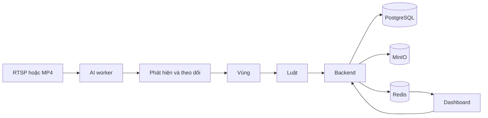

# AI Safety & Compliance Monitoring POC

Hệ thống xem camera nhà máy và công xưởng, đối chiếu luật an toàn lao động, và tạo incident để người vận hành xác nhận. AI không ra quyết định kỷ luật.

Bản đặc tả gốc nằm ở [docs/SPEC.md](docs/SPEC.md). Bản đó viết cho nhà máy cà phê. Từ 10/2026 phạm vi đổi sang nhà máy và công xưởng nói chung: bỏ dây chuyền hạt cà phê, hairnet và đồng phục; trọng tâm là đồ bảo hộ lao động (mũ, đồ bảo hộ, khẩu trang).

## Chạy trên máy

Cần Docker Desktop. Trong thư mục dự án:

```text
copy .env.example .env
docker compose up -d --build
```

Lần đầu sẽ tải image và build, có thể mất vài phút.

Mở:

| Việc | Địa chỉ |
|---|---|
| Dashboard | http://localhost:3000 |
| API Swagger | http://localhost:8000/docs |
| MinIO console | http://localhost:9101 |
| Worker health | http://localhost:8081/health |

Postgres và Redis chỉ chạy trong mạng Docker, không mở cổng ra máy.

Tài khoản demo:

| Người dùng | Mật khẩu | Việc được làm |
|---|---|---|
| admin | admin123 | Camera, vùng, luật |
| safety | safety123 | Duyệt incident |
| viewer | viewer123 | Chỉ xem |

MinIO: `safetyadmin` / `safetyadmin123`.

## Bản đồ hệ thống



Worker xử lý hình tại chỗ. API chỉ nhận incident, ảnh, và cấu hình. Dashboard nhận incident mới qua Server-Sent Events.

## Tình huống mẫu

Dữ liệu khởi tạo có nhà máy Factory POC và một camera giám sát an toàn lao động:

- Camera `CAM-WORKSHOP-01` (Workshop Camera 01) nhìn xuống sàn xưởng.
- Vùng **Workshop floor**, loại **PPE required area**: ai đứng trong vùng phải đủ đồ bảo hộ. Người ở trong vùng khi chân nằm trong polygon.
- Ba luật, mỗi món một luật:

| Luật | Incident | Mức |
|---|---|---|
| Helmet required | Thiếu mũ bảo hộ | HIGH |
| Protective clothing required | Thiếu đồ bảo hộ (áo liền quần) | HIGH |
| Mask required | Thiếu khẩu trang | MEDIUM |

Không có luật giày bảo hộ: với hình camera giám sát, màu sắc không phân biệt được giày bảo hộ với giày thường, và chân hay bị bàn che. Backend vẫn nhận điều kiện `SHOES_MISSING` để bật lại khi có `ppe.onnx` nhận được giày.

Mỗi món có ba trạng thái: Có, Không, Không xác định. Chỉ **Không** mới tạo incident, sau khi giữ đủ 2 giây. Không xác định, ví dụ người quay lưng nên không thấy mặt, hoặc chân bị che, thì không báo. Kết quả của một người chỉ chốt khi bốn trong sáu lần đọc gần nhất giống nhau.

Mỗi luật chạy riêng, nên một người thiếu hai món tạo hai incident. Người bị tracker mất dấu rồi bắt lại với số mới, cùng luật, gần chỗ cũ và trong thời gian cooldown thì vẫn dùng incident cũ. Muốn một khu chỉ bắt mũ thì tắt các luật còn lại ở trang **Rules**, hoặc vẽ thêm vùng và gắn luật cho vùng đó.

Trên ảnh camera, mỗi người có một thẻ: số, rồi một chữ cho mỗi món được kiểm tra: **H** mũ, **C** đồ bảo hộ, **M** khẩu trang. Xanh là có, đỏ là thiếu, xám là chưa xác định. Khung đỏ là có vi phạm. Chú giải nằm ở góc dưới bên phải.

Camera thứ hai, `CAM-RESTRICTED-01` (Restricted Area Camera 01), giám sát một khu vực hạn chế, ví dụ làn cân hay làn kiểm tra trong cảng:

| Luật | Incident | Mức |
|---|---|---|
| No entry for people | Có người trong khu vực hạn chế | HIGH |
| No entry for vehicles except forklifts | Có phương tiện trong khu vực hạn chế | HIGH |

Không ai được vào. Ô tô, xe tải, xe buýt, xe máy không được vào; xe nâng được phép. Người ngồi trong xe, ví dụ tài xế xe nâng, không bị tính là người đi vào. Loại xe do CLIP xác định (`models/clip_vision.onnx` và `models/vehicle_types.npz`); thiếu hai file này thì xe nâng bị nhận là xe tải và bị báo. Vùng "Restricted lane" lúc tạo chỉ là vùng tạm ở giữa khung hình: upload video rồi vào **Draw zones**, bấm **Redraw** để vẽ đúng làn.

Camera thứ ba, `CAM-HANDWASH-01` (Handwash Station Camera 01), đặt phía trên bồn rửa, nhìn thẳng xuống, kiểm tra quy trình rửa tay thường quy 6 bước của Bộ Y tế (cùng thứ tự với WHO):

| Bước | Động tác | Model của site (`handwash_steps.onnx`) | Model tham khảo (`handwash.onnx`) |
|---|---|---|---|
| 1 | Chà hai lòng bàn tay vào nhau | Có | Không: model không có lớp này |
| 2 | Chà lòng bàn tay lên mu và kẽ ngoài ngón tay bàn tay kia | Có | Có |
| 3 | Chà hai lòng bàn tay, miết mạnh các kẽ ngón | Có | Không: model không có lớp này |
| 4 | Chà mặt ngoài các ngón tay vào lòng bàn tay kia | Có | Không: nhầm sang bước 6 ở 9/10 ảnh thử |
| 5 | Xoay ngón cái trong lòng bàn tay kia | Có | Có |
| 6 | Xoay các đầu ngón tay trong lòng bàn tay kia | Có | Có, nhưng gần như luôn tính là có |

- Vùng **Sink**, loại **Hand-wash station**: vẽ quanh bồn rửa, chỗ tay rửa. Model của site nhìn đúng hình chữ nhật bao vùng này, nên phải vẽ giống lúc huấn luyện: trên camera hiện tại là từ 22% đến 82% bề ngang, hết chiều cao khung hình.
- Luật **WHO 6-step hand washing** (incident "Hand wash incomplete", mức MEDIUM). Mỗi lần rửa được chấm một lần, khi tay rời bồn quá 2,5 giây (`HANDWASH_GAP_S`) hoặc khi video upload chạy lại từ đầu. Bước nào làm chưa đủ 3 giây (ô "Min per step" ở trang **Rules**) là thiếu, và tạo một incident cho cả lần rửa. Ảnh incident ghi các bước bị thiếu. Tay xuất hiện dưới 3 giây thì không tính là một lần rửa.
- **Model của site** `models/handwash_steps.onnx` (có file này thì worker dùng nó): MobileNetV3-Small phân loại vùng bồn rửa thành không có tay, có tay nhưng không phải bước nào (làm ướt, lấy xà phòng, xả nước), hoặc một trong 6 bước. Huấn luyện bằng `tools/handwash_classifier/train_handwash.py` trên hai clip mẫu, lấy clip đúng làm chuẩn. Nhãn từng đoạn thời gian nằm trong `tools/handwash_classifier/labels/`, sửa được rồi huấn luyện lại.
- Huấn luyện chỉ trên clip đúng rồi thử trên clip sai (model chưa thấy clip này): đúng 87,5% khung hình. Trên camera, clip đúng qua cả 3 lần chạy; clip sai bị tách đúng thành hai lần rửa, cả hai bị báo thiếu bước ở cả 3 lần chạy. Mới chỉ có hai clip của một người ở một bồn, nên người khác, áo khác, ánh sáng khác cần thêm clip để huấn luyện.
- **Model tham khảo** `models/handwash.onnx` (YOLOv8n-seg của repo `synthetic-hand-washing`, chỉ học trên ảnh dựng 3D) chỉ dùng khi không có model của site. Với model này đặt `HANDWASH_SKIP_STEPS=fingers`. `HANDWASH_SCALE` (mặc định 0.6) thu nhỏ khung hình cho camera gần bồn. Chi tiết và giấy phép (trọng số Ultralytics là AGPL-3.0) xem `models/README.md`.
- Video upload chạy đúng tốc độ thật như camera thật.

Trên camera, tay đang rửa có thẻ "Wash Ns" và số của từng bước được kiểm tra: xanh là xong, xám là chưa, đỏ là thiếu (chỉ có trên ảnh incident). Có `models/hand_palm.onnx` và `models/hand_pose.onnx` (MediaPipe Hands từ OpenCV Zoo, Apache-2.0) thì mỗi bàn tay được vẽ thành bộ khung 21 khớp màu xanh teal, đầu ngón tay màu vàng cam, kiểu đang quét cử chỉ tay. Khung này chỉ để hiển thị, không dùng để chấm bước. Camera chỉ có luật rửa tay thì không chạy nhận diện người nữa.

Các mẫu luật vùng nguy hiểm máy và làn forklift vẫn còn trong trang **Rules** cho camera sau này.

Trong **AI Mode: DEMO**, ở khu vực hạn chế có một người đi vào, một ô tô chạy vào rồi ra, và một xe nâng đỗ bên trong (được phép). Trên sàn xưởng, worker tự tạo năm công nhân: một người đủ đồ, ba người mỗi người thiếu một món, và một người đứng yên mà AI không đọc được (để thấy Không xác định không báo). Bốn người đầu lần lượt đi vào rồi ra khỏi vùng. Ở bồn rửa, mỗi 70 giây có một lần rửa đủ 6 bước (không báo), rồi một lần chỉ làm 3 bước đầu (báo thiếu). Demo không cần file model. Banner trên dashboard ghi rõ đang ở DEMO.

Nút **Simulate an incident** trên trang camera giữ mọi người đứng trong vùng vài giây để luật chạy ngay.

Database đã khởi tạo từ bản cà phê được chuyển một lần khi backend khởi động: năm camera cũ (`CAM-PACK-01`, `CAM-PROD-01`, `CAM-MACHINE-01`, `CAM-WAREHOUSE-01`, `CAM-BEAN-01`) bị xóa cùng vùng, luật, incident và phần duyệt của chúng; camera tự thêm bằng tay được giữ; camera xưởng được thêm vào. Ảnh và video cũ trong MinIO không bị xóa. Muốn sạch hẳn thì chạy `docker compose down -v`.

## Việc nên thử

1. Đăng nhập `admin`.
2. Mở Workshop Camera 01. Bật **Show AI overlay** để thấy người, vùng và món đồ bảo hộ đang thiếu trên từng người. Khung đỏ là vi phạm, xám là chưa xác định, xanh là đủ đồ.
3. Vào **Draw zones**, bấm các góc trên ảnh, lưu polygon.
4. Vào **Rules**, chọn mẫu luật và vùng.
5. Đợi khoảng 20 giây, hoặc bấm Simulate. Incident xuất hiện ở Overview mà không cần tải lại trang.
6. Mở incident, xem ảnh, bấm Confirm, False positive, hoặc Resolve.

Upload MP4 ở trang camera nếu muốn dùng video thật làm nền. Worker phát lại file đó. RTSP điền vào ô stream URL, dạng `rtsp://user:password@địa-chỉ/stream`. Mật khẩu không được ghi ra log và không trả về nguyên văn trên API.

## Vùng và camera bị lệch

Người ở trong vùng khi điểm chân, tức giữa cạnh dưới của khung người, nằm trong polygon. Vùng vẽ được bao nhiêu góc cũng được, miễn các cạnh không cắt nhau. **Redraw** sửa hình vùng tại chỗ, luật và incident cũ vẫn gắn với vùng.

Mỗi vùng lưu khung hình đã dùng để vẽ. Khoảng mỗi giây, worker so khung hình hiện tại với khung đó:

| Kết quả so | Vùng |
|---|---|
| Lệch dưới 1% | Giữ nguyên |
| Lệch 1–20% | Dịch theo camera, nhãn ghi "auto-aligned" |
| Lệch hơn 20%, không khớp, hoặc vùng ra ngoài khung quá 40% | Tạm dừng: không vẽ trên khung hình, luật của vùng không chạy. Tự bật lại khi góc nhìn khớp lại |

Tạm dừng hay bật lại cần hai lần so liên tiếp cùng kết quả.

Camera xoay giữa nhiều góc (PTZ preset) thì bật **Camera has several views** trong Camera settings. Mặc định tắt. Các vùng khóa cùng một khung hình là một góc nhìn: mở Draw zones khi camera đang ở góc đó, vẽ hoặc bấm **Lock to this view** cho từng vùng của góc đó. Worker chỉ dùng góc nhìn khớp nhất với khung hình hiện tại; vùng của góc khác bị ẩn và không chạy luật. Đổi góc cần góc mới khớp hơn ít nhất 25% trong hai lần so liên tiếp. Không bật cho camera cố định: hai vùng vẽ vào hai ngày khác nhau sẽ thành hai góc nhìn và ẩn lẫn nhau. Trang camera có mục **Zones** ghi trạng thái từng vùng. Vùng vẽ trước khi có chức năng này giữ nguyên vị trí; bấm **Lock to this view** trong Draw zones nếu vùng đang khớp với khung hình.

## CPU và GPU

Mặc định chạy CPU. Dashboard không cần GPU.

Mỗi camera chạy model với `AI_THREADS` luồng, mặc định 2, và các luồng nghỉ giữa hai frame. Trên máy 22 luồng CPU, 4 camera đạt khoảng 27 FPS mỗi camera và dùng khoảng 4.5 lõi. Một camera trên máy nhiều lõi có thể tăng `AI_THREADS`; nhiều camera thì giữ thấp. Worker đọc cấu hình camera mỗi giây và gửi trạng thái lên backend hai lần mỗi giây, không theo từng frame.

`AI_MODE=REAL` dùng YOLOX-Nano khi có `models/person.onnx`, nhận diện toàn thân mà không yêu cầu thấy mặt. Cách tải model chính thức và checksum nằm ở [models/README.md](models/README.md). Không có model thì dùng OpenCV HOG. Khi chưa có `ppe.onnx`, worker đọc màu trên từng người, chỉ phù hợp kiểm thử POC với video rõ, chưa phù hợp triển khai thật:

- **Mũ:** mũ cứng trắng, vàng, cam hoặc đỏ ngay trên mặt là có; tóc hoặc da đầu là không.
- **Đồ bảo hộ:** áo liền quần, nghĩa là thân và chân cùng màu đồ lao động (xám, be, trắng, xanh). Áo màu sặc sỡ, hoặc áo màu đồ lao động với quần tối, là không. Không thấy chân thì để Không xác định.
- **Khẩu trang:** cần `models/face.onnx` (detector mặt YuNet, MIT) để tìm mặt. Có thêm `models/mask.onnx` thì một model nhỏ đã train phân loại từng khuôn mặt: đeo đúng, không đeo, đeo sai cách; bắt được cả mặt nghiêng không đeo khẩu trang. Khẩu trang kéo xuống dưới cằm vẫn chưa bắt được. Không có `mask.onnx` thì dùng màu: thấy màu khẩu trang ở cằm là có, mặt nhìn thẳng mà cằm cùng màu da trán là không.

Trên video xưởng 30 giây khoảng 15 người, cách này mở đúng 2 incident cho 2 vi phạm thật (một người không đội mũ, một người mặc áo thun) và không báo sai. Video đó không có ai bỏ khẩu trang, nên phần "không khẩu trang" mới kiểm tra trên ảnh tổng hợp. Chi tiết và cách tải `face.onnx` ở [models/README.md](models/README.md).

Video quay demo nên thấy trọn người từ mũ đến chân, người không che nhau, người cao ít nhất khoảng 1/4 khung hình; người vi phạm khẩu trang thì quay mặt về camera. Worker xử lý khung 1280x720.

Đặt file ONNX vào thư mục `models/`:

| File | Hợp đồng |
|---|---|
| `person.onnx` | YOLOX-Nano chính thức: đầu vào 1x3x416x416 BGR 0..255, đầu ra raw 1x3549x85; class COCO 0 là người. |
| `forklift.onnx` | Ra tensor Nx6: x1, y1, x2, y2, score, class trong tọa độ ảnh đầu vào model. Class 1 là forklift. |
| `face.onnx` | YuNet 2023mar của OpenCV Zoo, MIT. Tìm mặt trong vùng đầu của từng người để kiểm tra khẩu trang và mũ. |
| `mask.onnx` | MobileNetV3-Small phân loại khuôn mặt: đeo sai cách, đeo đúng, không đeo. Train bằng `tools/mask_classifier/train_mask.py`; nguồn dữ liệu và giấy phép ở [models/README.md](models/README.md). |
| `ppe.onnx` | Detector đồ bảo hộ, chạy trên ảnh cắt của từng người. Tám lớp: 0 helmet, 1 no_helmet, 2 clothing, 3 no_clothing, 4 shoes, 5 no_shoes, 6 mask, 7 no_mask. Chấp nhận tensor Nx6 hoặc đầu YOLO `(1, 12, anchors)`. Mỗi món lấy box mạnh nhất nằm đúng phần cơ thể: mũ ở đầu, khẩu trang ở mặt, áo ở thân, giày ở chân. Cách train và export ở [models/README.md](models/README.md) và `tools/ppe_yolo`. |

GPU trên máy Linux có NVIDIA Container Toolkit:

```text
docker compose -f docker-compose.yml -f docker-compose.gpu.yml up -d --build
```

Image mặc định vẫn là CPU. Muốn inference CUDA thì cài `onnxruntime-gpu` trong image worker và giữ `AI_DEVICE=cuda`.

## Giấy phép model

- OpenCV và bộ HOG phát hiện người: Apache-2.0.
- Theo dõi người: ByteTrack qua thư viện supervision, Apache-2.0.
- ONNX Runtime: MIT.

Không dùng Ultralytics YOLO vì giấy phép AGPL.

## Theo dõi

- `http://localhost:8000/health`, `/ready`, `/metrics`
- `http://localhost:8081/health`, `/ready`, `/metrics`

Metric của worker gồm trạng thái camera, số frame, FPS, độ trễ inference, số phát hiện, số incident, và frame bị bỏ.

Trang Evaluation cho tỷ lệ false positive trên các incident đã được người duyệt. Đó chưa phải độ chính xác của model. Recall cần nhãn các vụ bị bỏ sót, POC này chưa thu thập phần đó.

## Dừng và xóa dữ liệu

Dừng, giữ database và ảnh:

```text
docker compose down
```

Xóa toàn bộ dữ liệu POC, gồm Postgres và MinIO:

```text
docker compose down -v
docker compose up -d --build
```

## Kiểm tra đã chạy

```text
docker compose ps
```

Backend và worker phải healthy. Đăng nhập xong phải thấy camera Workshop Camera 01 và các incident mẫu về mũ, đồ bảo hộ và khẩu trang.
